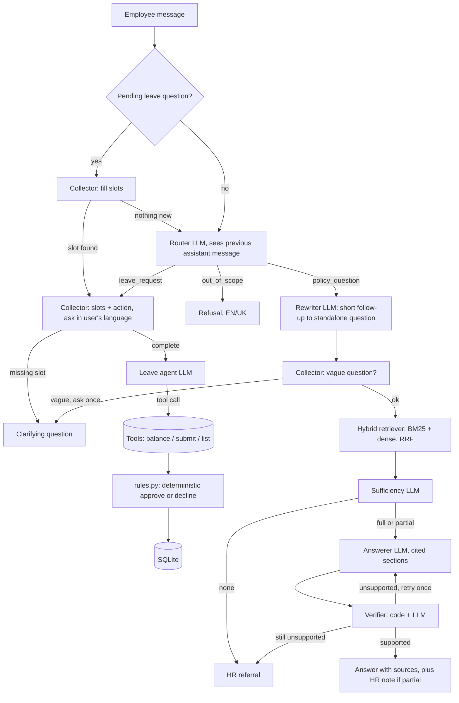

# System diagram and components

| Component | Purpose | Input -> Output | Model call / tool |
|---|---|---|---|
| Router | Intent: policy / leave / out of scope | message + previous assistant message -> label | LLM |
| Collector | Extract leave slots (type, dates, action), flag vague policy questions | message, known slots -> slots, missing, question | LLM + code validation |
| Retriever | Find relevant policy sections | question -> top-k section chunks | BM25 + sentence-transformers (no generation) |
| Rewriter | Make a short follow-up self-contained | message + previous turn -> standalone question | LLM |
| Sufficiency | How well do excerpts cover the question: full / partial / none | question, chunks -> coverage | LLM |
| Answerer | Short grounded answer with citations | question, chunks, employee context -> text + citations | LLM |
| Verifier | Every claim supported by cited text? | answer, cited items -> supported? | code (citation exists) + LLM |
| Leave agent | Book / check leave only through tools | message, slots -> reply + tool calls | LLM + tools |
| Rules engine | Approve / decline by policy | request, balance, calendar -> decision + reason | deterministic code |

Walkthrough ("Can I work from abroad?"): router -> policy_question; collector -> not vague; retriever -> remote_work.md#3 first;
sufficiency -> covered; answerer -> "up to 20 working days per year, 10 days notice" citing remote_work.md §3.1, §3.2;
verifier -> supported; the UI shows the answer and the cited items.
